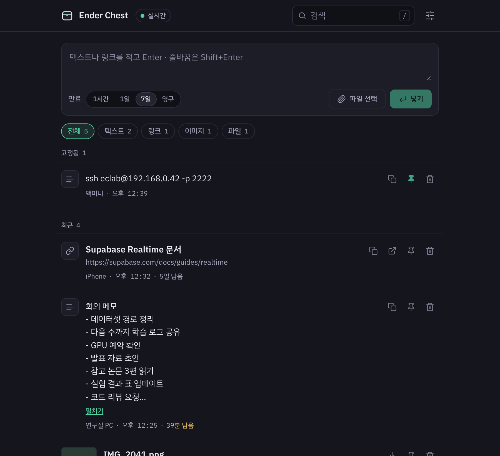
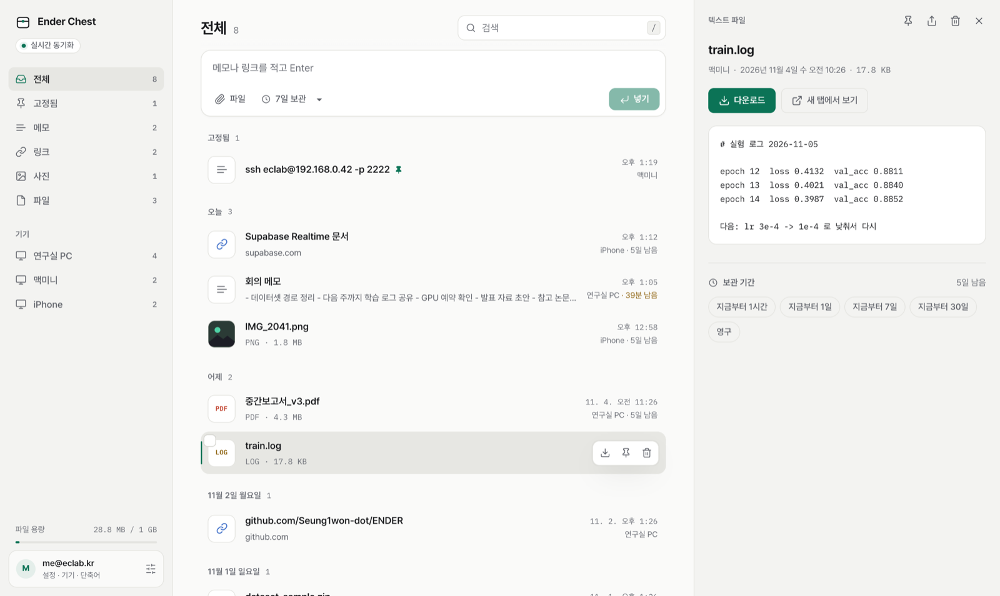
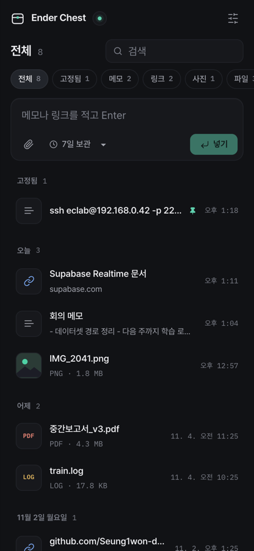

# Ender Chest

어디서 열어도 같은 내용물이 보이는 나만의 상자입니다. 폰에서 넣으면 PC 에서 바로 꺼내고, PC 에서 넣으면 폰에서 바로 꺼냅니다. 메신저 "나에게 보내기" 를 대신하려고 만든 개인용 PWA 입니다.

| 항목 | 내용 |
|------|------|
| 기간 | 2026-09-25 ~ (2026-11-05 작업 화면 개편) |
| 역할 | 개인 프로젝트 (기획·디자인·개발) |
| 기술 스택 | React 18 · TypeScript · Vite · Supabase · Motion · Anime.js |
| 형태 | PWA (PC 브라우저 설치 / 아이폰 홈 화면 + 단축어) |
| 운영 비용 | 0원 |
| 상태 | v2 — 3단 작업 화면·미리보기·여러 개 선택 |

<p>
  
  
</p>

<sub>작업 화면 — 다크 / 라이트(보관함 · 목록 · 미리보기). 개발용 미리보기 페이지(가짜 데이터)에서 캡처했습니다.</sub>

<p></p>

## 목차

- [주요 기능](#주요-기능)
- [기술 스택](#기술-스택)
- [시작하기](#시작하기)
- [배포와 기기 등록](#배포와-기기-등록)
- [보안 메모](#보안-메모)
- [프로젝트 구조](#프로젝트-구조)
- [더 읽을거리](#더-읽을거리)

## 주요 기능

카톡 "나에게 보내기" 를 대신하려면 **넣기·찾기·꺼내기가 메신저보다 빨라야** 한다는 기준으로 만들었습니다.

- **넣기** — 화면 어디서든 **Ctrl+V**(글·이미지·파일), 창에 **끌어다 놓기**(여러 개 동시 업로드), 입력창 Enter. 아이폰은 공유 시트 → 단축어 ([iOS 단축어 만들기](docs/ios-shortcuts.md)).
- **실시간** — 한 기기에서 넣으면 다른 기기에 바로 뜹니다. 창을 옆에 띄워 두면 새 항목에 점이 찍히고, 탭 제목에 개수가 붙고, (설정에서 켜면) 데스크톱 알림이 옵니다.
- **정리** — 날짜별(오늘·어제·요일) 타임라인, 고정 묶음, 보기(메모·링크·사진·파일), **기기별 모아 보기**, 검색(`/`, 파일 이름·내용·기기).
- **미리보기** — 오른쪽 창에서 바로 봅니다: 이미지, 동영상, 오디오, PDF, 코드·로그·CSV 같은 텍스트 파일, 메모 전체(편집 가능), 링크. 폰에서는 전체 화면, 뒤로 가기로 닫힙니다.
- **꺼내기** — 한 번에 복사·다운로드, 새 탭에서 열기, 다른 앱으로 공유. **여러 개 선택**(Shift/⌘ 클릭, ⌘A) 후 한꺼번에 다운로드·복사·고정·삭제.
- **키보드** — `↑↓`(또는 `j k`) 이동, `Enter` 복사/다운로드, `C` 복사, `D` 다운로드, `O` 열기, `P` 고정, `X` 선택, `Delete` 삭제, `Esc` 닫기.
- **안전한 삭제** — 지운 뒤 5초 안에 "되돌리기".
- **보관 기간** — 1시간·1일·7일·30일·영구(기본 30일). 항목마다 미리보기에서 나중에 바꿀 수 있습니다. 사이드바에 파일 용량(무료 1GB 기준)이 보입니다.

## 기술 스택

| 구분 | 기술 | 쓴 이유 |
|------|------|---------|
| 프론트엔드 | React 18, TypeScript, Vite, vite-plugin-pwa | 설치형 앱처럼 쓰는 가벼운 단일 화면 |
| 모션 | Motion(목록·미리보기·선택 전환), Anime.js v4(빈 상자 인트로) | 상태 변화만 짧게 알려 주는 용도 |
| 글꼴 | Pretendard(본문), IBM Plex Mono(시각·용량) | 한글 가독성, 숫자 정렬 |
| 백엔드 | Supabase (Auth, Postgres + RLS, Storage, Realtime, Edge Function) | 서버 없이 인증·실시간·파일 저장을 한 번에 ([ADR-001](docs/ADR/001-supabase-and-no-server.md)) |
| 테스트 | Vitest | 순수 로직(`src/lib`) 단위 테스트 |
| 배포 | Vercel | 정적 빌드 무료 호스팅 |

## 시작하기

### 사전 요구사항

- Node.js 와 npm
- Supabase 프로젝트 (화면만 볼 때는 필요 없음 — 아래 [화면만 미리 보기](#화면만-미리-보기))

### 1. Supabase 준비

1. https://supabase.com 에서 프로젝트를 만듭니다 (Region: Seoul 권장).
2. SQL Editor 에서 `supabase/migrations/0001_init.sql`, `0002_storage.sql` 을 순서대로 실행합니다.
3. Authentication → Sign In / Providers
   - 상단 **"Allow new users to sign up" ON**
   - Email 항목의 **Enable Email provider ON**, 개인용이면 **Confirm email OFF** 권장
   - 토글 하나를 끄다가 옆 토글까지 꺼지는 실수가 잦으니 한 번 더 확인합니다.
4. Authentication → URL Configuration
   - Site URL: 배포 주소 (예: `https://enderchest.vercel.app`)
   - Redirect URLs: `http://localhost:5173/**`, `https://enderchest.vercel.app/**`
5. Project Settings → API 에서 **Project URL** 과 **anon public key** 를 복사합니다.

### 2. 설치

```bash
npm install
```

### 3. 환경변수

```bash
cp .env.example .env   # VITE_SUPABASE_URL, VITE_SUPABASE_ANON_KEY 채우기
```

값이 비어 있으면 앱이 흰 화면 대신 어떤 변수가 빠졌는지 알려 주는 안내 화면을 띄웁니다.

### 4. 실행

```bash
npm run dev
```

브라우저에서 http://localhost:5173 을 엽니다.

### 검사

```bash
npm run check   # 타입체크 + 단위 테스트 + 빌드
```

### 화면만 미리 보기

로그인 없이 화면만 보려면 개발 서버에서 http://localhost:5173/preview.html 을 엽니다. 가짜 항목으로 상자 화면·빈 상자·새 항목 도착·삭제·고정·토스트를 눌러 볼 수 있습니다. 개발 전용 페이지라 빌드에는 포함되지 않습니다.

`.env` 가 없어도 로그인 화면 미리보기까지 보려면 가짜 값으로 띄웁니다.

```bash
VITE_SUPABASE_URL=http://localhost:54321 VITE_SUPABASE_ANON_KEY=dev npm run dev
```

## 배포와 기기 등록

### Vercel 배포

1. GitHub 에 push 합니다.
2. https://vercel.com → GitHub 로 로그인 → Add New Project → 이 저장소 Import.
3. 빌드 설정은 `vercel.json` 에 있습니다(`npm run build` → `dist`). Environment Variables 에 `VITE_SUPABASE_URL`, `VITE_SUPABASE_ANON_KEY` 를 추가합니다. 값을 바꾼 뒤에는 다시 배포해야 반영됩니다.
4. Deploy → `https://<프로젝트>.vercel.app`. 이 주소를 Supabase URL Configuration 에 등록합니다(시작하기 1-4).

### 단축어용 Edge Function 배포

아이폰 단축어로 넣으려면 `share` 함수를 한 번 배포합니다. JWT 검증 끄기(`verify_jwt = false`)는 `supabase/config.toml` 에 들어 있습니다.

```bash
SUPABASE_ACCESS_TOKEN=<개인 액세스 토큰> npx supabase functions deploy share --project-ref <프로젝트 ref>
```

### 기기 등록

- **PC/맥**: 브라우저 주소창의 "설치" 아이콘 → 독립 창 앱으로.
- **아이폰**: Safari → 공유 → "홈 화면에 추가". 공유 시트에서 바로 넣으려면 [iOS 단축어](docs/ios-shortcuts.md)를 만듭니다(토큰 발급 → 단축어 2개).
- 설정(상단 오른쪽 아이콘)에서 기기 이름을 정하면 각 항목에 출처로 표시됩니다.

## 보안 메모

- 데이터는 내 Supabase 프로젝트에만 저장됩니다. 모든 테이블 RLS `auth.uid() = user_id`, Storage 는 경로 첫 폴더 = uid.
- 파일은 비공개 버킷 + 1시간 서명 URL 로만 열립니다.
- 단축어 토큰은 SHA-256 해시만 저장하고, 생성 직후 1회만 보여 줍니다.
- `service_role` 키는 Edge Function 런타임 환경변수에만 둡니다. 저장소에 넣지 마세요.

## 프로젝트 구조

```text
src/
  components/       화면 (상자·입력창·목록·필터 칩·토스트·설정)
  hooks/            세션 · 실시간 목록 · 붙여넣기 · 드롭존 · 서명 URL
  lib/              순수 로직 + Supabase 데이터 계층 (vitest), 모션 값(motion.ts)·인트로(intro.ts)
  preview/          개발 전용 미리보기 페이지 (preview.html)
  styles/           전역 CSS · 색 토큰
supabase/
  migrations/       스키마 · RLS · Storage 정책
  functions/share/  아이폰 단축어용 Edge Function
docs/               기획서 · 스펙 · ADR · iOS 단축어 · 스크린샷
```

## 더 읽을거리

- [기획서](docs/PLAN.md)
- [구현 스펙](docs/superpowers/specs/2026-09-25-ender-chest-v1-design.md) · [구현 계획](docs/superpowers/plans/2026-09-25-ender-chest-v1.md)
- [ADR-001: Supabase 와 서버 없는 구조](docs/ADR/001-supabase-and-no-server.md)
- [iOS 단축어 만들기](docs/ios-shortcuts.md)
- [화면 기준 DESIGN.md](DESIGN.md) — 색·글꼴·구성·[모션 규칙](DESIGN.md#motion). 화면을 고칠 때 먼저 읽습니다.
- [제품 기준 PRODUCT.md](PRODUCT.md)
- [진행 기록 PROGRESS.md](docs/PROGRESS.md)

## 라이선스

[MIT License](LICENSE)
